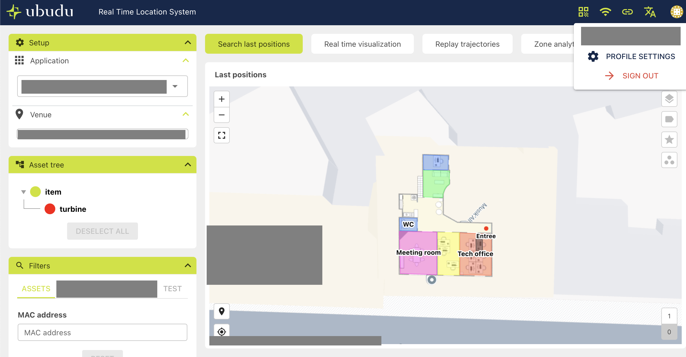
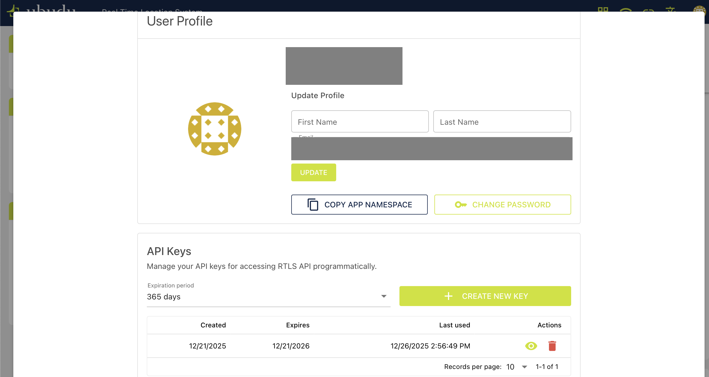

# Getting started

This guide installs the SDK, creates a client, explains authentication and the default context, and points to
the domain guides.

## 1. Install and requirements

```bash
npm install ubudu-rtls-sdk
```

- Node.js `>=20.3.0`. The SDK is tested on Node 20, 22 and 24.
- WebSocket streaming on Node 20 needs the optional peer dependency `ws` (`npm install ws`); Node 22 and later
  have a global `WebSocket`. See the [WebSocket guide](./websocket.md).
- Bun 1.4.4 is verified as a consumer runtime of the published package (ESM and CommonJS imports and REST calls).
  Tests, build and tooling of this repository run on Node only.
- The package ships ESM (`import`) and CommonJS (`require`) builds with TypeScript declarations. Browsers use it
  through a bundler (see [Runtime support](#10-runtime-support)).

## 2. Credentials

You need two values from the RTLS web application: the **application namespace** and an **API key**.

1. Sign in to the RTLS web application, open the menu under your user name and choose **PROFILE SETTINGS**.

   

2. On the profile settings page, **COPY APP NAMESPACE** copies the namespace. In the **API Keys** section, pick an
   expiry and click **CREATE NEW KEY**, then reveal and copy the key.

   

In your own code, read both values from environment variables or a secret store; never put them in source code.

The repository examples read a `.env` file at the repository root (variables already set in the environment win):

```bash
APP_NAMESPACE=<your namespace>
RTLS_API_KEY=<your API key>
# optional, default https://rtls.ubudu.com/api
RTLS_BASE_URL=https://rtls.ubudu.com/api
```

`.env` is listed in `.gitignore`; never commit it.

## 3. First client

`createRtlsClient` builds a client. `health()` checks that the API answers (`GET /health` returns
`{ status: 'OK' }`; a server that is not ready answers 503).

```ts
import { createRtlsClient } from 'ubudu-rtls-sdk';

const client = createRtlsClient({
  apiKey: process.env.RTLS_API_KEY,
  namespace: process.env.APP_NAMESPACE,
});

const health = await client.health();
console.log(health.status);
```

Most namespaces hold one venue. Make it the default venue of the client, so venue-scoped calls need no id:

<!-- snippet: prelude=client -->
```ts
const [venue] = await client.venues.list();
client.setVenue(venue.id);

const maps = await client.venues.listMaps();
console.log(`${maps.length} map(s) in venue ${venue.name}`);
```

## 4. Authentication

| Option | Header sent |
|---|---|
| `apiKey` | `X-API-Key: <key>` |
| `accessToken` | `Authorization: Bearer <token>` |

The SDK sends exactly one credential header. When both options are set, the Bearer token is sent (`auth: 'auto'`,
the default). The `auth` option chooses explicitly:

```ts
import { createRtlsClient } from 'ubudu-rtls-sdk';

const client = createRtlsClient({
  apiKey: process.env.RTLS_API_KEY,
  accessToken: process.env.RTLS_ACCESS_TOKEN,
  auth: 'apiKey', // 'auto' | 'apiKey' | 'bearer'
  namespace: process.env.APP_NAMESPACE,
});
```

## 5. Client options

| Option | Type | Default | Meaning |
|---|---|---|---|
| `baseUrl` | `string` | `https://rtls.ubudu.com/api` | API base URL: an `http:` or `https:` URL, or a root-relative path (`/rtls-api`) for a same-origin proxy in a browser; a trailing `/` is removed |
| `apiKey` | `string` | — | sent as `X-API-Key` |
| `accessToken` | `string` | — | sent as `Authorization: Bearer` |
| `auth` | `'auto' \| 'apiKey' \| 'bearer'` | `'auto'` | which credential to send when both are set (`auto`: Bearer) |
| `timeoutMs` | `number` | `30000` | per-attempt timeout (headers and body); `0` or `Infinity` disables it |
| `retry` | `boolean \| RetryPolicy` | `false` | opt-in retries of idempotent requests (see the [error handling guide](./error-handling.md#7-retries)) |
| `fetch` | `typeof fetch` | global `fetch` | custom `fetch` implementation |
| `headers` | `Record<string, string>` | — | headers sent on every request (`Content-Type` is ignored) |
| `namespace` | `string` | — | default namespace |
| `venueId` | `number` | — | default venue |
| `mapId` | `number` | — | default map; read only by the deprecated map-level routes |
| `level` | `number` | — | default floor level of the spatial zone and POI lookups and of navigation |

Invalid options (for example a negative `timeoutMs`, or a `baseUrl` that is neither an http(s) URL nor a
root-relative path) throw a `ValidationError` with `status` 0 when the client is created.

## 6. Default context

The namespace, venue, map and level set on a client are the defaults of the calls that use them (see the notes
below). Change them on the client (the setters return the client, so they chain); the getters `context`,
`namespace`, `venueId`, `mapId` and `level` return the defaults currently set (`context` is a copy):

<!-- snippet: prelude=client -->
```ts
client.setNamespace('other-namespace').setVenue(42).setMap(7).setLevel(0);
client.setContext({ venueId: 43, mapId: 8 });
console.log(client.context, client.namespace, client.venueId);
client.clearContext();
```

Scoped clients copy the context and leave the original client unchanged. They share its connection settings, so
one client per tenant or venue is cheap:

<!-- snippet: prelude=client -->
```ts
const tenant = client.forNamespace('tenant-a');
const venueClient = client.forVenue(42, { mapId: 7 });
const mapClient = client.forMap(7, { level: 1 });
const custom = client.withContext({ venueId: 42, level: 0 });

const [tenantAssets, venueZones] = await Promise.all([
  tenant.assets.list(),
  venueClient.zones.listAsArray(),
]);
console.log(tenantAssets.length, venueZones.length, mapClient.mapId, custom.level);
```

Every method takes the context per call in its last parameter (`options?: CallContext & RequestOptions`); a
per-call value wins over the default:

<!-- snippet: prelude=client -->
```ts
const zones = await client.zones.listAsArray({ venueId: 43 });
const assets = await client.assets.list({ namespace: 'tenant-b' });
console.log(zones.length, assets.length);
```

When a call needs a namespace, venue or map that neither the call nor the client provides, the SDK throws a
`ContextError` before sending anything:

<!-- snippet: prelude=client -->
```ts
import { ContextError } from 'ubudu-rtls-sdk';

const withoutVenue = client.withContext({ venueId: undefined });
try {
  await withoutVenue.zones.list();
} catch (err) {
  if (err instanceof ContextError) console.log(`missing ${err.field}: ${err.suggestion}`);
  else throw err;
}
```

An invalid id or `level` (for example `level: 0.5`) throws a `ContextError` too, also before sending anything.

Notes:

- Assets, positions and notifications are namespace-wide; they ignore `venueId`.
- Navigation always needs a venue: the SDK sends the venue with every routing request and raises `ContextError`
  when none is set.
- Venue, map, zone, POI and path listings ignore the default `level`; pass `level` per call to filter by floor
  (`client.forMap(7, { level: 1 }).zones.listAsArray()` returns the zones of every floor). The default `level`
  applies to the spatial zone and POI lookups and to the route points given without their own `level`.
- The default `mapId` is read only by the deprecated map-level routes (`zones.listByMap()`,
  `zones.listByMapAsArray()`, `venues.listMapPois()`).

Code that extends the SDK, for example a helper over `client.raw`, can resolve the context the same way:
`resolveContext(defaults, overrides)` lays the call's values over the client's, and `requireNamespace`,
`requireVenueId` and `requireMapId` throw the same `ContextError` as the SDK's own methods when a value is missing
or invalid:

<!-- snippet: prelude=client -->
```ts
import { requireVenueId, resolveContext } from 'ubudu-rtls-sdk';

function venueOf(venueId?: number): number {
  return requireVenueId(resolveContext(client.context, { venueId })).venueId;
}
console.log(venueOf(42));
```

## 7. Cancellation and timeouts

Every call accepts an `AbortSignal` and its own `timeoutMs` (`0` disables the timeout for that call):

<!-- snippet: prelude=client -->
```ts
const controller = new AbortController();
setTimeout(() => controller.abort(), 5_000);

const positions = await client.positions.listCached({ signal: controller.signal, timeoutMs: 0 });
console.log(positions.length);
```

An aborted call throws `AbortError`, an expired timeout `TimeoutError` (see the
[error handling guide](./error-handling.md#6-timeouts-and-cancellation)).

## 8. Resources

| Property | Domain | Guide |
|---|---|---|
| `client.assets`, `client.assetDocuments`, `client.assetTree`, `client.dataModels`, `client.declaredLocations`, `client.tagActions` | assets, documents, declared locations, BLE tag actions | [Assets](./assets.md) |
| `client.positions`, `client.spatial` | live and historical positions, spatial queries | [Positions and spatial](./positions-spatial.md) |
| `client.venues`, `client.zones`, `client.navigation` | venues, maps, zones, POIs, paths, routing | [Venues and navigation](./venues-navigation.md) |
| `client.dashboards`, `client.alerts`, `client.alertRules`, `client.settings` | dashboards, alerts, alert rules, settings | [Dashboards and alert rules](./dashboards-alert-rules.md) |
| `client.notifications` | notification inbox, sending, rules, live stream | [Notifications](./notifications.md) |
| `client.etl` | data imports | [ETL](./etl.md) |
| `RtlsWebSocketSubscriber`, `RtlsWebSocketPublisher` | real-time streaming | [WebSocket](./websocket.md) |
| `client.health()` | API health | this guide |

An operation the SDK does not wrap is reachable through `client.raw`, the typed openapi-fetch client on the same
base URL and credential; it has no default context, timeout, retry or error mapping (see
[Operations the SDK does not wrap](../api/README.md#operations-the-sdk-does-not-wrap-clientraw)).

Cross-cutting topics: [error handling](./error-handling.md), [pagination and filtering](./pagination-filtering.md).

## 9. Typed results

Every result is typed; import the types from the package:

<!-- snippet: prelude=client -->
```ts
import type { Asset } from 'ubudu-rtls-sdk';

const assets: Asset[] = await client.assets.list();
const names = assets.map((a) => a.user_name);
console.log(names.length);
```

Asset MACs are stored as 12 lowercase hexadecimal characters. Methods that take a MAC accept the usual forms and
normalise them; the helpers are exported:

```ts
import { formatMac, isValidMac, normalizeMac } from 'ubudu-rtls-sdk';

console.log(normalizeMac('02:5D:4B:00:00:01')); // '025d4b000001'
console.log(formatMac('025d4b000001')); // '02:5D:4B:00:00:01'
console.log(isValidMac('not-a-mac')); // false
```

## 10. Runtime support

- Node.js `>=20.3.0` (tested on 20, 22 and 24); Bun 1.4.4 verified as a consumer runtime for REST calls.
- ESM (`import`) and CommonJS (`require`) builds (the CommonJS form is below).
- Browsers: through a bundler. The SDK uses `fetch` (with streamed response bodies for the notification stream),
  `AbortController` and timers.
- Cross-origin browser code can read only the `X-Last-Positions-Source` response header. `X-Total-Count`,
  `Retry-After` and `Content-Disposition` are not readable there (known server issue USI-P1-4): an offset page
  then has no `total`, a rate-limit error has no `retryAfter`, and a download has no file name. Server-side code
  is not affected. A same-origin proxy avoids the limit: with a root-relative `baseUrl` (`/rtls-api`) the requests
  are not cross-origin and these headers are readable. `createWebSocket()` resolves such a `baseUrl` against the
  page; outside a browser it needs `subscriberUrl` and `publisherUrl`.

```js
const { createRtlsClient } = require('ubudu-rtls-sdk');

const client = createRtlsClient({ apiKey: process.env.RTLS_API_KEY, namespace: process.env.APP_NAMESPACE });
client.health().then((h) => console.log(h.status));
```

## 11. Running the examples

The repository has runnable examples in TypeScript and JavaScript for every domain. They read the root `.env`
(section 2), are read-only by default and are listed in [examples/README.md](../../examples/README.md).

```bash
npm ci && npm run build
npm run examples:install
cd examples
npm run ts -- typescript/01-getting-started.ts
npm run js -- javascript/01-getting-started.js
```

## 12. Next steps

- [Error handling](./error-handling.md): error classes, timeouts, retries.
- [Pagination and filtering](./pagination-filtering.md): listing models, the filter DSL.
- The domain guides of [section 8](#8-resources).
- [Recipes](../recipes/README.md): complete scenarios built from several domains.
